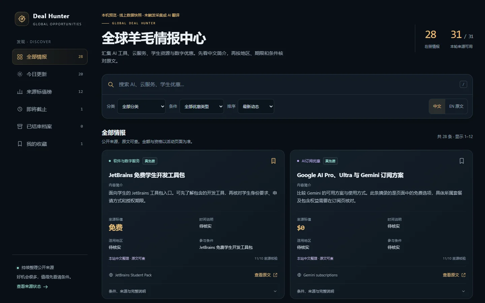
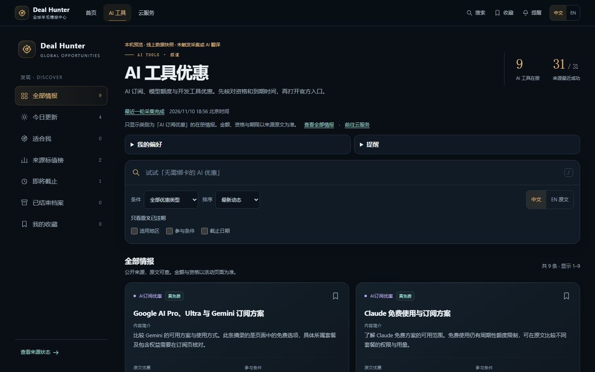
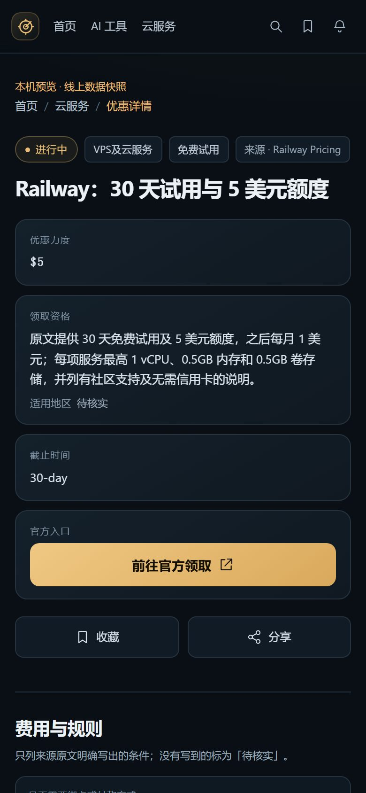

# GLOBAL DEAL HUNTER｜全球羊毛情报中心

公开的优惠情报站。它按固定规则抓取一批公开 RSS/Atom 和官方页面，把来源原文里写明的优惠整理进看板。来源没有写的金额、日期、地区、条件，页面上显示「待核实」，不会补造。

[访问线上门户](https://dealhunter.gongjiang667.workers.dev/)。门户首页、AI 工具频道、云服务频道和完整看板已上线。首页推荐榜在 [PR #4](https://github.com/jjh-python667/dealhunter/pull/4) 审阅中，等待发布。

[GitHub 源码](https://github.com/jjh-python667/dealhunter) · [个人作品集](https://jjh-python667.github.io/projects/dealhunter.html)




截图都是本机预览，使用公开数据快照；截图记录开发时的界面。尚未覆盖的新内容在后台翻译完成前会保留原文。

## 完整看板与本机预览（`/deals`）

门户化之后，`/` 是新的门户首页，原来的完整看板搬到 `/deals`；旧 `/?view=…`、`/?offer=…` 链接会自动跳转，筛选参数保留。

使用 **motion-design** 技能，保留暗色、金色和青色识别，重做导航、字体层级、卡片、留白、手机筛选和轻量动效。重要切换采用位置与透明度组合，支持系统「减少动态效果」，不引入动效库、视频、WebGL 或远程字体。

新增功能：

- 全部、今日、来源标值榜、即将截止、归档、收藏六种视图。同一条优惠只生成一张卡片，分类、优惠类型和搜索可组合使用。
- 每页 12 条，支持排序、页码、结果计数、清空搜索及无结果恢复。筛选、语言和页码写入 URL，刷新可以恢复。
- 收藏仅保存在当前浏览器；禁用存储时回退到本次会话，不影响查询。
- 保留中文／原文切换、部分翻译提示和原文回退。公开页面不调用翻译管理接口，不会因点击语言切换而产生模型调用。
- 完整条件、来源、风险和归档原因保留在详情里，来源健康记录默认折叠。
- `/deals` 聚焦搜索，Esc 清除；支持键盘焦点、屏幕阅读器结果提示，以及无 JavaScript 时查看全部记录。

推荐 Node.js 24。在源码目录执行：

```bash
npm ci
npm run preview
```

打开 [本机预览](http://127.0.0.1:43118/)。预览使用 `preview/snapshot.json` 中的公开线上快照，页面明确标为本机预览，不写入远程 D1、不触发采集、不调用 AI。当前 28 条记录已配有中文标题、摘要和内容简介，常见时间、条件及标值也有中文显示；切到「EN 原文」可对照收录原文。

中文整理在 `src/content/zh-guides.ts`，按来源、标题和摘要精确匹配；原文变化后立即停用旧中文，避免误套在新的活动上。后台已有的机器译文优先保留，与「本站中文整理」分开标注。未覆盖的新条目继续显示原文，后续由原有后台翻译处理。此处没有新增模型调用，也没有改动优惠金额、资格判断或日期推算。

生产入口仍是 `src/index.ts`。路由解析在 `src/routes.ts`，看板布局在 `src/page.ts`，门户首页在 `src/ui/home.ts`，详情页在 `src/ui/detail.ts`，顶部导航与共享卡片在 `src/ui/nav.ts`、`src/ui/shared.ts`，样式与交互分离在 `src/ui/`。`npm run preview` 会监听源码变化。

本轮验证：139 项测试、类型检查、Worker dry-run 打包通过；headless Edge 在本机预览上跑完 33 项浏览器验收（首页→频道→详情→官方入口、搜索/筛选/分页/收藏/提醒、旧链接 302 与旧锚点、390px 与 1440px 均无横向溢出），并生成桌面与手机截图。领取反馈另做了本机真实 HTTP 验收（去重、限流、条款版本失效、管理员复核）。本机验收不等同于 Cloudflare 线上 CPU 或模型效果验证。

GitHub Actions 在 Ubuntu 与 Windows 的 Node.js 24 环境执行测试、类型检查和本地打包检查。

### 门户快照与本地压测

成功采集后生成首页（含推荐榜）、AI 频道和云服务频道的中英文快照。D1 保存 gzip 压缩的 HTML，边缘按页面和语言缓存最多 60 秒。浏览器的筛选与偏好照常在本机处理。快照新鲜期最多 20 分钟，遇到优惠生效、截止或日期切换时提前失效。超过新鲜期会优先读实时页面，实时读取失败时可回退到仍在有效期内的快照。上线时先应用 `0004_portal_snapshots.sql` 迁移，再等一轮成功采集生成快照。

响应头 `X-Dealhunter-Cache` 可区分 `EDGE`、`SNAPSHOT`、`STALE`、`LIVE` 和 `BYPASS`。`Server-Timing` 提供快照查询和首页优惠查询各自的 D1 读行数，首页的采集状态查询单独执行。

```bash
npm run build:check
node scripts/bench-snapshots.cjs
```

默认每组 200 请求、20 并发，可用 `BENCH_REQUESTS` 和 `BENCH_CONCURRENCY` 调整。压测使用 Miniflare、本地 D1 和公开样本，输出缓存命中率、p95、读行数和样本发现延迟。历史样本发现延迟包含最初导入的旧优惠，生产采集延迟应使用上线后的新记录另测。

## 门户首页、AI/云频道与独立详情页

门户将优惠按首页、频道、完整看板与独立详情页组织。

| 地址 | 页面 |
| --- | --- |
| `/` | 门户首页：今日精选（1 主推 + 2–3 次推，证据不足留空）、最新收录、即将截止、适合我 |
| `/deals` | 完整看板：全部视图、搜索、分类/优惠类型/证据筛选、12 条分页、收藏、偏好与提醒 |
| `/ai-tools` | AI 工具频道：只含 AI 订阅优惠，复用搜索、地区/条件/截止筛选和分页 |
| `/cloud` | 云服务频道：只含 VPS 及云服务 |
| `/deal/<id>` | 独立详情页：第一屏优惠力度、领取资格、截止时间、官方入口；下方绑卡、自动续费、试用后计费、领取步骤与原文证据，缺失显示「待核实」 |

兼容与边界：

- 旧看板链接 `/?view=saved&q=…` 会 302 到 `/deals?…`，筛选参数原样保留；旧锚点 `/#sec-a`…`/#sec-h`、`#sources` 由首页脚本转发到 `/deals` 对应视图。
- 收藏、偏好和提醒沿用原来的浏览器 key（`dh-saved`、`dh-preferences`、`dh-alerts-v1`），升级不丢。
- 已结束或归档的优惠仍可用 `/deal/<id>` 打开，页首标明状态并保留原文证据。
- 精选只从「仍在有效期内、来源原文写明优惠力度与至少一项资格/期限信息」的条目里挑；证据不足时整段留空，不补造。
- 首屏标题用遮罩揭开和位移归位，精选卡错峰进场；系统开启「减少动态效果」时全部关闭。详情页有 canonical 和 og 标签，链接可直接分享。
- 搜索表单使用普通 GET 提交，CSP 由 `form-action 'none'` 放宽为 `form-action 'self'`，无 JavaScript 也能跳到 `/deals`。
- 详情页有匿名「领取状态反馈」：还能领 / 已失效 / 不确定；按优惠条款版本去重，并为公开提示单独设置了去重、限流和人工复核门槛。详见下方「领取状态反馈」。






### 本机验收路线

```bash
npm ci
npm run preview
```

打开 <http://127.0.0.1:43118/>，按「首页 → 频道 → 详情 → 官方入口」走一遍：

1. 首页顶部导航依次是「首页、AI 工具、云服务」，右侧有搜索、收藏、提醒入口；首屏往下依次是今日精选、最新收录、即将截止、适合我。
2. 点「AI 工具」或「云服务」进入频道，试一下搜索、优惠类型、地区/条件/截止筛选项和分页；点卡片右上角书签收藏，再从导航「收藏」进入收藏视图确认还在。
3. 点任意卡片标题或「查看详情」进入 `/deal/<id>`。第一屏应能看到优惠力度、领取资格、截止时间；点「前往官方领取」会在新窗口打开官方地址。
4. 详情页往下是费用与规则（绑卡、自动续费、试用后计费）、领取步骤、原文证据；来源没写的内容显示「待核实」。
5. 手机验收：浏览器开发者工具切到 390px 宽（或真机），重复 1–3，重点看首屏四要素完整、没有横向滚动条。
6. 旧链接验收：打开 `/?view=saved` 应自动跳到 `/deals?view=saved`；打开 `/?offer=<旧优惠 id>` 也应回到 `/deals` 并展开对应条目。

### 领取状态反馈（本次新增，待上线）

详情页官方入口下方有一块「领取状态反馈」：三选一（还能领 / 已失效 / 不确定），无需登录。

- 提交按「优惠 ID + 条款版本 + 浏览器随机标识」去重；同一版本重复提交返回「你已反馈过这版优惠」，不会重复计票。
- 限流：同一浏览器 10 分钟内最多 3 次、24 小时内最多 10 次。原始 IP 不落库，只用于当天的短期网络分组摘要。
- 公开提示只统计最近 72 小时、当前条款版本、未被人工压下的反馈；至少 3 个不同浏览器且来自 2 个网络分组才显示「近三天有访客反馈可领取」。2 个不同网络分组反馈「已失效」时暂停正向提示，进入人工复核。
- 公开页面只显示汇总提示，不显示提交者标识或网络标识。审核用 `POST /api/admin/feedback/review`（同一个 `ADMIN_TOKEN`）把单条反馈标记为 `kept` / `held`。
- `migrations/0005_feedback.sql` 是新增表。线上已应用 0001、0002、0003_translation_queue、0004_portal_snapshots；0005 尚未应用到线上 D1。本轮只写代码，**没有操作远程数据库、没有部署**。
- 本机预览里的反馈只存在内存中，刷新预览进程即清空，方便试用，不写入 D1。

### 个性化优惠雷达

1. 打开「我的偏好」，选择地区、分类及付款条件，点击「保存偏好」进入「适合我」。偏好、收藏和站内提醒保存在当前浏览器。
2. 搜索支持「无需绑卡的 AI 优惠」「美国可领的云服务」等常见条件。付款与续费规则依赖来源明确表述，信息缺失或冲突时会在详情中显示。
3. 「提醒」支持匹配的新优惠、收藏即将截止和收藏条款变化。可逐项开关，也可选择次日打开网站时查看日汇总。打开页面时，页面每分钟检查最近的采集轮次，发现更新后提供刷新入口。

## 它做什么

- 7 个类别：AI 订阅优惠、Crypto、U 卡、海外银行、VPS 及云服务、软件与数字服务、其他。
- 采集 Cron `*/15 * * * *` 每 15 分钟运行一个分组。OpenAI、Vercel、AWS、Google Cloud 公告每组检查，其他来源按 UTC 分钟分为四组，每小时覆盖一轮。翻译继续由独立的 Cron 调用。
- 用规范化后的官方链接去重。同一条再次出现时更新验证时间，不新增一行。
- 只有来源文本里带有截止提示（until、through、ends、截止等）的日历日期才会写成截止日。`90 days`、`30-day`、`for a limited time` 只保留原文，不换算成某一天。
- 截止日已过的条目标成归档。官方页面这次对不上原先那句原文时，也会归档，并写明原因。RSS 里不再出现的旧条目不会因此归档。
- 排序只用来源里能读出来的信息：写明的美元或稳定币金额优先，然后是其他货币（不换汇）、百分比、额度、定性的「免费」，「待核实」排在最后。
- Crypto、海外银行、U 卡一律带固定风险提示。
- 链接会去掉常见跟踪参数和邀请参数。联盟跳转域名、`/invite/`、`/referral/` 路径直接丢弃。

优惠类型只在原文对得上时才标成：真免费、免费试用、需充值、需交易量、需邀请。对不上就是「待核实」。有明确截止日的「免费」会标成免费试用，因为来源自己写了结束时间。

## 架构

```text
Cron / 管理接口
    → src/collect.ts 逐个抓取种子源（最多读 160KB）
    → src/parse.ts 解析 RSS/Atom（每源最多 15 条，每条最多 12KB）
    → src/extract.ts 判断是不是优惠、抽日期、金额、条件、地区
    → 本地或远程 D1（deals / runs / source_checks；领取反馈另存 deal_feedback）
    → src/page.ts 渲染中文看板
```

公开只读：

- `GET /` 门户首页
- `GET /deals` 完整看板（原 `GET /` 的全部视图；旧链接自动 302 到这里）
- `GET /ai-tools`、`GET /cloud` 两个频道
- `GET /deal/<id>` 独立详情页（归档记录也返回 200，页面标明状态）
- `GET /api/health`
- `GET /api/board`
- `GET /api/runs` 最近一轮采集和每个来源的 HTTP 结果

写入只有：

- `POST /api/admin/collect`，请求头 `Authorization: Bearer <ADMIN_TOKEN>` 或 `X-Admin-Token`
- `POST /api/feedback`：匿名领取状态反馈（`works` / `expired` / `unknown`），无账号、无自由文本，带去重与限流
- `POST /api/admin/feedback/review`：把单条反馈标记为 `kept` / `held`，同一个 `ADMIN_TOKEN`
- Cron 触发的 `scheduled()`

令牌用 `crypto.subtle.digest("SHA-256")` 之后再比较。环境里没有 `ADMIN_TOKEN` 时管理接口返回 503，不会变成公开写入。令牌不进仓库。本地放 `.dev.vars`（已忽略），仓库里只有 `.dev.vars.example`。

看板分区：

| 分区 | 内容 |
| --- | --- |
| A 今日最新优惠 | 北京时间当天。有来源发布时间就用发布时间，没有就用第一次收录时间 |
| B 高价值优惠排行榜 | 按上面的排序，最多 12 条 |
| C AI工具免费与折扣专区 | AI |
| D Crypto空投与积分专区 | Crypto |
| E 海外银行与银行卡优惠 | 海外银行 + U 卡 |
| F VPS及云服务专区 | VPS / 云 |
| G 即将截止的活动 | 有日历截止日，且在未来 7 个 UTC 日期内 |
| H 已结束活动档案 | 已过截止日，或页面原文对不上了 |

软件与数字服务没有单独字母区，出现在情报流以及 A、B、G、H。

## 种子来源与这次本地核验

下面是 2026-11-10 在这台机器上、用最终代码触发 `scheduled()` 的结果。31 个种子全部 HTTP 200，没有抓取失败。`收录 0` 表示页面打开了，但最近条目里没有对上优惠规则，系统没有编一条进去。

| 来源 | URL | HTTP | 看到 | 收录 |
| --- | --- | --- | --- | --- |
| Ollama Blog | https://ollama.com/blog/rss.xml | 200 | 15 | 2 |
| Google Cloud Blog | https://blog.google/products/google-cloud/rss/ | 200 | 15 | 2 |
| DigitalOcean Blog | https://www.digitalocean.com/blog/rss | 200 | 8 | 1 |
| Kraken Blog | https://blog.kraken.com/feed | 200 | 10 | 1 |
| Vercel Changelog | https://vercel.com/atom | 200 | 15 | 1 |
| Neon Blog | https://neon.tech/blog/rss.xml | 200 | 15 | 1 |
| OpenAI News | https://openai.com/news/rss.xml | 200 | 15 | 0 |
| Ethereum Foundation Blog | https://blog.ethereum.org/feed.xml | 200 | 15 | 0 |
| Cloudflare Blog | https://blog.cloudflare.com/rss/ | 200 | 11 | 0 |
| GitHub Changelog | https://github.blog/changelog/feed/ | 200 | 10 | 0 |
| AWS What's New | https://aws.amazon.com/about-aws/whats-new/recent/feed/ | 200 | 15 | 0 |
| Claude Pricing | https://claude.com/pricing | 200 | 1 | 1 |
| Google One | https://one.google.com/about/ | 200 | 1 | 1 |
| Gemini subscriptions | https://gemini.google/subscriptions/ | 200 | 1 | 1 |
| Google Cloud Free Program docs | https://docs.cloud.google.com/free/docs/free-cloud-features | 200 | 1 | 1 |
| Neon Pricing | https://neon.com/pricing | 200 | 1 | 1 |
| Railway Pricing | https://railway.com/pricing | 200 | 1 | 1 |
| Supabase Pricing | https://supabase.com/pricing | 200 | 1 | 1 |
| Fly.io Pricing | https://docs.fly.io/about/pricing | 200 | 1 | 1 |
| Cloudflare Workers Pricing | https://developers.cloudflare.com/workers/platform/pricing/ | 200 | 1 | 1 |
| Monzo Current Account | https://monzo.com/current-account | 200 | 1 | 1 |
| N26 | https://n26.com/en-eu | 200 | 1 | 1 |
| Starling Bank | https://www.starlingbank.com/ | 200 | 1 | 1 |
| Ally Bank Spending Account | https://www.ally.com/bank/interest-checking-account/ | 200 | 1 | 1 |
| Privacy.com | https://www.privacy.com/ | 200 | 1 | 1 |
| Curve | https://www.curve.com/ | 200 | 1 | 1 |
| Azure account offers | https://azure.microsoft.com/en-us/pricing/purchase-options/azure-account | 200 | 1 | 1 |
| GitHub Pricing | https://github.com/pricing | 200 | 1 | 1 |
| GitHub Student Developer Pack | https://education.github.com/pack | 200 | 1 | 1 |
| JetBrains Student Pack | https://www.jetbrains.com/academy/student-pack/ | 200 | 1 | 1 |
| Anthropic Newsroom | https://www.anthropic.com/news | 200 | 1 | 1 |

这一轮写入 28 条，更新 0，归档 0，跳过 136 条不像优惠的 feed 条目。类别计数（全部为未归档）：

| 类别 | 条数 |
| --- | --- |
| AI订阅优惠 | 9 |
| VPS及云服务 | 9 |
| 海外银行 | 4 |
| 软件与数字服务 | 3 |
| U卡 | 2 |
| Crypto | 1 |
| 其他 | 0 |

紧接着又触发了一次同一个 Cron。结果是新增 0、更新 28、归档 0。同一条优惠没有变成第二行。

官方页面只在预设句子真的出现在抓到的 HTML 里才入库。GitHub Student Developer Pack 最多保留 6 条页面上以 “Offer $…” 开头的原文，这次只匹配到 1 条。

### 探过但没有当作种子的地址

这些地址在同一次调查里请求过，不进入定时采集：

| URL | 结果 | 原因 |
| --- | --- | --- |
| https://www.anthropic.com/news/rss.xml | 404 | 新闻室没有这个 RSS。改用上面的 HTML 新闻页，并且只匹配写明折扣的那一句 |
| https://www.binance.com/en/feed 与 `/en/support/announcement/rss` | 202，正文为空 | 没有可解析的公告 |
| https://www.coinbase.com/blog/rss | 403 | 拒绝访问 |
| https://www.revolut.com/ | 403 | 拒绝访问 |
| https://www.oracle.com/cloud/free/ | 403 | 拒绝访问 |
| https://wise.com/us/card/ 与 https://wise.com/gb/card/ | HTTP 200，正文是站内 404 | 不能当成优惠页 |
| https://wise.com/us/ | 200 | 只有费率计算器样例和营销句，没有可单独引用的优惠额度，未入库 |
| https://aws.amazon.com/free/ | 200 | 可见文本没有具体免费额度。定时任务改用 What's New RSS，这一轮也没有优惠句 |
| https://www.okx.com/fees | 200 后跳到费用表 | 费用表不是促销，未入库 |

没有使用需要登录的页面，也没有使用付费 API 或 API key。

## 本地运行

需要 Node.js 22+。

```bash
npm install
cp .dev.vars.example .dev.vars
# 把 ADMIN_TOKEN 换成一段长随机字符串。不要提交 .dev.vars。
npm run migrate:local
npm run dev
```

开发服务器在 <http://127.0.0.1:43117> 。`npm run dev` 等价于：

```bash
npx wrangler dev --local --ip 0.0.0.0 --port 43117 --test-scheduled --show-interactive-dev-session=false
```

`--local` 使用本机 D1，不会碰远程库。本地 Cron 不会自己按钟点跑。要手动触发和线上一样的定时处理器：

```bash
curl "http://127.0.0.1:43117/cdn-cgi/local/scheduled?cron=0+%2A%2F2+%2A+%2A+%2A"
```

手动采集（会再抓一遍外网）：

```bash
curl -X POST http://127.0.0.1:43117/api/admin/collect \
  -H "Authorization: Bearer <你的 ADMIN_TOKEN>"
```

错误令牌返回 401，GET 该路径返回 405。没配置令牌时返回 503。

本地数据库文件在 `.wrangler/state/`，已忽略。想清空重来就删掉这个目录，再执行 `npm run migrate:local`。

## 测试

```bash
npm test
```

使用 Node 自带测试运行器，经 `tsx` 执行 `test/**/*.test.ts`。覆盖去重与跟踪参数、联盟/邀请链接丢弃、截止日期提取、过期判断、排序、空字段显示为「待核实」、页面原文消失后的归档计划，以及 `ADMIN_TOKEN` 门禁。

运行 `npm test` 和 `npm run typecheck`。当前共 139 项测试通过，涵盖原有采集、鉴权与翻译，以及页面去重、中文覆盖、原文变更后的失效处理、原文回退、归档状态、链接安全与日期格式；门户化后新增路由解析与 302 旧链接、Worker 各路由状态码、首页精选规则与旧 hash 跳转、两个频道的作用域过滤与筛选控件、详情页第一屏四要素/费用规则/原文证据/归档状态与 XSS 防护；反馈功能另覆盖三选一校验、条款版本失效、去重/限流、公开汇总门槛、冲突复核与管理员令牌。改绑定后重新运行 `npm run types`。

## 更新现有 Worker

以下记录早期版本的发布流程。目标是现有的 `dealhunter` 与其 D1；不新建数据库，也不操作 `newsdesk`。

1. `npx wrangler whoami`，确认登录的是拥有现有 Worker 的账号；需要时再登录。
2. 核对 `wrangler.jsonc` 中的 Worker 名称和 D1 绑定，使用现有 `dealhunter` 数据库。
3. 线上已应用 0001、0002、0003_translation_queue、0004_portal_snapshots；本轮新增的只有 `0005_feedback.sql`（领取反馈表），尚未上线。部署时用 `npx wrangler d1 migrations apply dealhunter --remote` 应用 0005；不编辑已应用的迁移。本轮没有执行远程迁移。
4. 保留现有 `ADMIN_TOKEN`。仅当尚未配置时，使用 `npx wrangler secret put ADMIN_TOKEN` 的交互输入，不把令牌写进命令参数或源码。
5. `npm test && npm run typecheck`，再执行 `npx wrangler deploy --dry-run --outdir dist`。
6. 确认构建正确后执行 `npx wrangler deploy`。通过 Cloudflare 连接器部署时，先运行 `node deploy/build-translate-deploy.cjs` 更新部署脚本，然后再使用其输出。

普通预览不需要 Cloudflare 登录或密钥。翻译模型的真实输出与用量，需要上线绑定后单独验证；本轮没有发起模型请求。

部署后检查现有线上地址。定时任务由 Cloudflare Cron 执行，本地的 `/cdn-cgi/local/scheduled` 只存在于 `wrangler dev`。

### 免费额度

按 Cloudflare 文档（Workers Limits、Workers Pricing、D1 Pricing；D1 免费档每日读写限制已在执行）：

| 项目 | Workers Free |
| --- | --- |
| 请求 | 每天 10 万次，UTC 零点重置 |
| CPU | 每次 HTTP 请求和每次 Cron 10ms。等待网络不算 CPU。本地 `wrangler dev` 不强制这个上限 |
| 外部子请求 | 每次调用 50 次。本采集大约 31 次直连，没有预留多少次重定向 |
| Cron | 每个账号最多 5 条。这里只用 1 条 |
| D1 读取 | 每天 500 万行 |
| D1 写入 | 每天 10 万行 |
| D1 存储 | 账号合计 5 GB |
| D1 数据库个数 | 10 |

每 2 小时跑一次，大约每天 12 次 Cron。单次大约 8 秒墙钟（这次本地测量），远低于 Cron 15 分钟墙钟上限。真正要担心的是免费档 10ms CPU：本地开发不模拟这个限制，所以不能声称线上 Cron 一定跑得完。如果线上出现 Error 1102，先减少 `src/sources.ts` 里的种子，而不是升配。本项目不使用付费功能。

## 如何回滚

- Worker 代码：`npx wrangler deployments list` 看版本，然后 `npx wrangler rollback`。这只回滚 Worker 脚本，不回滚 D1 里的行，也不取消已经发出的 Cron。
- 想停采集：从 `wrangler.jsonc` 去掉 `triggers.crons` 后再部署。已经写进 D1 的优惠还在。
- 错误迁移：不要改已经应用过的 `migrations/*.sql`。新写一条迁移修正。远程迁移应用过之后，本地和远程的迁移记录是分开的。
- 占位 `database_id` 如果被误拿去部署，会指向一个不存在或错误的库。部署前必须换成 `wrangler d1 create` 打印的 id。

## 没有自动化、或做不到的事

对应原始需求第七部分。下面这些都没有假装完成：

- 分类、金额、日期、优惠类型仍是规则和正则，不由大模型编造。翻译独立处理标题和摘要，判断不了的字段仍标「待核实」。
- 不能登录交易所、银行、厂商后台，也不能绕过 403。Binance、Coinbase、Revolut、Oracle Cloud 免费页这次打不开，所以没有它们的条目。
- 不渲染需要执行 JavaScript 才出现的正文。首屏 HTML 里没有的句子不会被收录。
- 不把「30 天」「90 天」「限时」换算成日历截止日，所以这些条目不会进入「即将截止」，也不会因为时间过去而自动归档。
- RSS 滚出最近 15 条，不代表活动结束，因此不会自动归档。只有写明的截止日过了，或官方页面的原句消失了，才进档案。
- 参与步骤几乎总是「待核实」。来源没有给出步骤列表时，不会编「打开网站、注册、完成任务」。
- 不同货币不换算。百分比折扣没有基准价时，不会估一个美元价值。排序因此是粗排，不是估价。
- 不做推送、邮件、Telegram、Slack。这些需要另外的连接器和权限。
- 不验证你能不能真正参加。它只复述抓到的原文，并在金融类条目上加固定风险提示。
- 不包含联盟链接、邀请链接或推荐码。
- 此处验收记录针对当时的本机构建。

## 中文翻译（2026-11-10 新增，待上线）

- 页面右上方有「中文 / EN 原文」切换，默认中文。没有译文的条目一律显示英文原文。选择会存进浏览器 localStorage，也可用 `?lang=en` 直接打开英文。
- 译文存进 D1 新列（`migrations/0002_translation.sql`）：`zh_title`、`zh_summary`、`zh_status`（done / skip / error）、`zh_engine`、`zh_at`、`zh_attempts`。请求时不翻译。
- 引擎：Workers AI `@cf/meta/m2m100-1.2b`，通过 `AI` 绑定调用（`src/translate.ts`）。
- 单独的 Cron `30 */2 * * *`（采集之后 30 分钟）只做翻译，不和采集共用一次调用的 CPU。也可 `POST /api/admin/translate`（同一个 ADMIN_TOKEN）手动补一批。
- 只翻新条目：`zh_status IS NULL` 的活跃行，每批默认 6 行，每天（UTC）默认最多 80 行，单段最多 480 字符。环境变量 `TRANSLATE_BATCH` / `TRANSLATE_DAILY_MAX` / `TRANSLATE_MAX_CHARS` 可调，但代码里有硬上限 12 / 150 / 600。已是中文的行标 skip，不调用模型。
- 英文原文变了，旧译文自动清空并重新排队；没变就保留。失败最多重试 3 次。模型报错（比如免费额度用完）就停这一批。
- 关闭翻译：把 `TRANSLATE_ENABLED` 设成 `0`，或去掉 `ai` 绑定。页面自动退回原文。
- 本地开发没有 AI（AI 绑定只能走远程）：用 `wrangler.local.jsonc`（同配置、去掉 ai）跑 `wrangler dev -c wrangler.local.jsonc`，翻译 Cron 会返回 `no_ai_binding`。
- 一键上线：`npx wrangler deploy --dry-run --outdir dist && node deploy/build-translate-deploy.cjs`，再把 `deploy/translate-deploy.js` 交给 Cloudflare 连接器 execute 执行（迁移 0002、上传 Worker 并保留 ADMIN_TOKEN、两个 Cron）。
